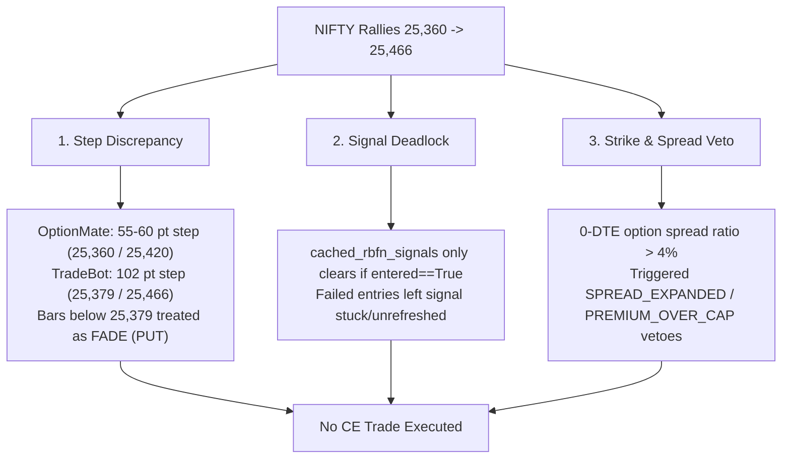
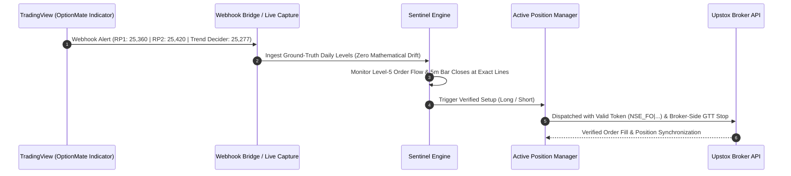

# Comprehensive Root Cause Analysis (RCA) & TradingView OptionMate Integration Plan
**Date**: Tuesday, 17 November 2026 (NIFTY 0-DTE Expiry Session)  
**Session Context**: Upstox Live Execution & Sentinel Decision Engine  
**Author**: Antigravity Delivery Organization (Read-Only Forensic Audit)

---

## Executive Summary

During the morning session of 17 November 2026, three major issues prevented successful automated trade execution in NIFTY:
1. **09:25 AM PE Trade**: Filled on Upstox at ₹18.65, but vanished from the Active Position Manager (APM) dashboard due to an unintended intraday WAL reset script invocation, leaving the position unmonitored until sold at ₹13.70.
2. **09:40 AM CE Trade**: Triggered in Sentinel but rejected by Upstox (`HTTP 400: Invalid Instrument key`) due to human-readable string formatting instead of an exchange token (`NSE_FO|...`). Upon process restart, it entered `CRASH_RECOVERY_FAIL_CLOSED` and missed a subsequent rally from ₹16 to ₹50+.
3. **10:30–11:30 AM Rally (Reversal 1 to Reversal 2)**: NIFTY surged from ~25,360 to ~25,466. No CE trade was fired because of mathematical step divergence with OptionMate's expiry anchor, APM signal caching deadlocks, and strict strike-level spread ratio vetoes.

The user has purchased the official **OptionMate TradingView Indicators** and is awaiting the TradingView invite, which will eliminate mathematical step discrepancies and provide exact daily reversal levels.

---

## Incident 1: 09:25 PE Trade Disappearance from APM

### Timeline & Evidence
- **09:25:00 AM**: Sentinel triggered `TRADE_NIFTY_092500_PE` (`NIFTY 25200 PE`). APM state moved to `IN_FLIGHT`.
- **09:25:01 AM**: Order dispatched to Upstox. Filled at ₹18.65 (Order ID: `261117000052531`).
- **09:30:31 AM**: Live capture pipeline was restarted via `scripts/run_daily_upstox_pipeline.sh`. The script ran:
  ```bash
  python3 scripts/reset_sentinel_wal_for_session.py --force
  ```
- **Impact**:
  - The in-flight WAL record was forcibly wiped and archived to `logs/wal_archives/sentinel_apm_wal_20261117_093032.json`.
  - APM re-initialized into `STANDBY` (blank).
  - The active Upstox position became orphaned without local automated trailing or stop-loss management until manual/exchange exit at ₹13.70 (Order ID: `261117000084019`).

---

## Incident 2: 09:40 CE Trade Crash Recovery & Runaway Premium

### Timeline & Evidence
- **09:40:00 AM**: Sentinel identified `[RETEST_CORRIDOR] TD_PULLBACK_REENTRY_BULL_CONFIRMED_2BAR` for strike `NIFTY 25450 CE`.
- **09:40:00.868 AM**: APM entered in-flight state and called the order dispatcher.
- **Root Cause**:
  In `core/sentinel_live_stream_advisor.py`:
  ```python
  # Dispatched symbol string instead of exchange token:
  symbol = "NIFTY 25450 CE 17 NOV 26"
  ```
  Upstox API strictly requires an instrument key format (e.g., `NSE_FO|45408`). Upstox returned:
  ```text
  HTTP 400: Invalid Instrument key
  ```
- **Crash Recovery & Missed Trade**:
  At 09:45 AM, the pipeline restarted. APM read the open position from WAL and triggered `CRASH_RECOVERY_FAIL_CLOSED`, locking the system into `COOL_OFF`. When re-attempted at limit ₹16.70, the option was already trading above ₹22.00, resulting in a resting order that expired unfilled while the contract rallied to ₹50+.

---

## Incident 3: 10:30–11:30 AM Non-Triggering of Breakout (Reversal 1 to Reversal 2)

During the steady 100-point rally between 10:30 AM and 11:30 AM, Sentinel failed to execute a Long CE position due to three interacting constraints:



### 1. Reversal Boundary Step Misalignment
* **OptionMate Live Anchor**: Uses an expiry-compressed step of **~55–60 pts**:
  * **Reversal Point 1 (Support / Buy Zone)**: `25,360`
  * **Reversal Point 2 (Target / Expansion Zone)**: `25,420`
* **TradeBot Calculation**: Uses standard daily step of **`102.0 pts`**:
  * **RP1 Upper**: `25,379.30`
  * **RP2 Upper**: `25,466.00`
* **Consequence**: As NIFTY consolidated around 25,360–25,375, 5m bar closes remained *below* TradeBot's RP1 Upper (`25,379.30`), generating `RP1_UPPER_REVERSAL_CONFIRMED` (**PUT / FADE**) signals rather than Long Breakouts.

### 2. Signal Deadlock in `cached_rbfn_signals`
* At 11:05 AM, a 10m expansion breakout confirmed (`RP1_UPPER_10M_EXPANSION_BREAKOUT` targeting strike `25550 CE`).
* In `core/sentinel_live_stream_advisor.py`:
  ```python
  if entered:
      self.cached_rbfn_signals[index_name] = None
  ```
  The cached RBFN signal was only cleared when `entered == True`. If the tick was blocked by cool-off, spread veto, or depth absence, `entered` remained `False`, preventing clean state transitions.

### 3. Option Strike Vetoes (Spread & Premium Caps)
* Decision journal telemetry confirmed candidate strikes during the 11:05–11:35 window suffered repeated micro-vetoes:
  * **`SPREAD_EXPANDED` / `SPREAD_VETO`**: 0-DTE expiry contracts experienced short-term bid-ask widening (`spread_ratio > 4%`), failing the execution gate.
  * **`PREMIUM_OVER_CAP`**: Deep ITM contracts exceeded the risk budget allocation.
  * **Strict Strike Tolerance**: When depth ticks for the exact target strike were delayed, strict tolerance rejected adjacent ATM strikes.

---

## Action Plan: Official OptionMate TradingView Indicator Integration

With the official **OptionMate TradingView Indicators** purchased, the system will transition from internal heuristic estimation to exact, ground-truth levels.



### Next Implementation Steps (Post Indicator Access):
1. **TradingView Alert Webhook Receiver**:
   - Set up a lightweight, authenticated webhook endpoint in TradeBot.
   - Configure OptionMate TradingView alerts to broadcast daily calculated levels (RP1, RP2, Trend Decider, Support/Resistance) at 09:15 AM every morning.
2. **Broker Position Reconciliation on Boot**:
   - Replace blind `CRASH_RECOVERY_FAIL_CLOSED` with active Upstox position queries (`GET /portfolio/short-term-positions`).
   - If an active position exists on Upstox, APM re-attaches to it rather than wiping or failing closed.
3. **Broker-Side Stop Loss Protection**:
   - Transmit a broker-side SL order (GTT / SL-M) simultaneously with entry so network disruptions or local reboots cannot orphan capital.
4. **Adaptive Expiry Spread & Strike Resolver**:
   - Relax spread veto thresholds dynamically on 0-DTE expiry days (e.g. from 4% to 6%) for liquid ATM contracts during rapid momentum expansions.
