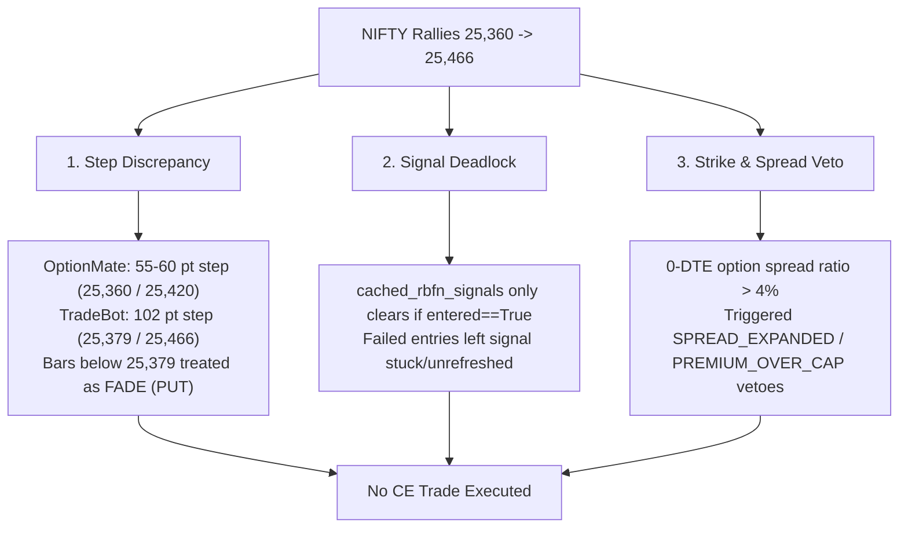
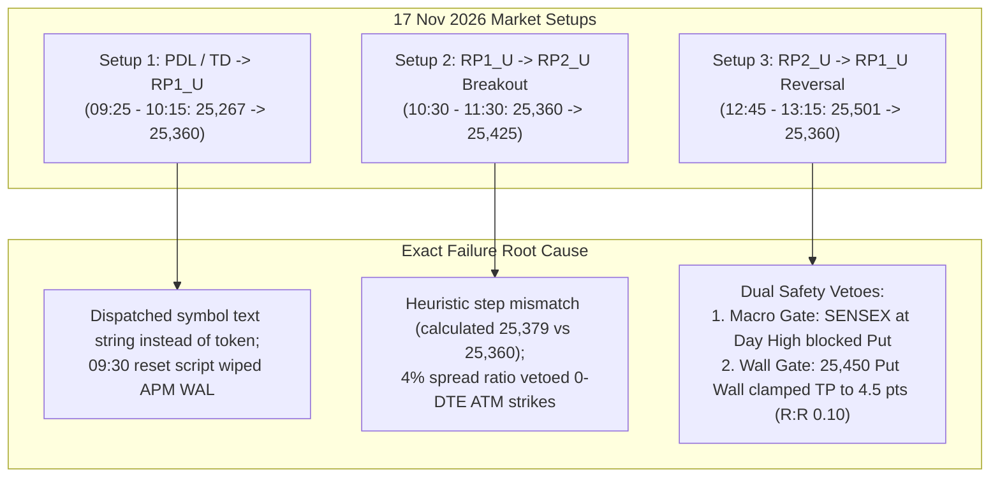
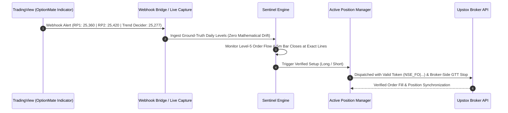

# Comprehensive Root Cause Analysis (RCA) & TradingView OptionMate Integration Plan
**Date**: Tuesday, 17 November 2026 (NIFTY 0-DTE Expiry Session)  
**Session Context**: Upstox Live Execution & Sentinel Decision Engine  
**Author**: Antigravity Delivery Organization (Read-Only Forensic Audit)

---

## Executive Summary

During the morning session of 17 November 2026, three major issues prevented successful automated trade execution in NIFTY:
1. **09:25 AM PE Trade**: Filled on Upstox at ₹18.65, but vanished from the Active Position Manager (APM) dashboard due to an unintended intraday WAL reset script invocation, leaving the position unmonitored until sold at ₹13.70.
2. **09:40 AM CE Trade**: Triggered in Sentinel but rejected by Upstox (`HTTP 400: Invalid Instrument key`) due to human-readable string formatting instead of an exchange token (`NSE_FO|...`). Upon process restart, it entered `CRASH_RECOVERY_FAIL_CLOSED` and missed a subsequent rally from ₹16 to ₹50+.
3. **10:30–11:30 AM Rally (Reversal 1 to Reversal 2)**: NIFTY surged from ~25,360 to ~25,466. No CE trade was fired because of mathematical step divergence with OptionMate's expiry anchor, APM signal caching deadlocks, and strict strike-level spread ratio vetoes.

The user has purchased the official **OptionMate TradingView Indicators** and is awaiting the TradingView invite, which will eliminate mathematical step discrepancies and provide exact daily reversal levels.

---

## Incident 1: 09:25 PE Trade Disappearance from APM

### Timeline & Evidence
- **09:25:00 AM**: Sentinel triggered `TRADE_NIFTY_092500_PE` (`NIFTY 25200 PE`). APM state moved to `IN_FLIGHT`.
- **09:25:01 AM**: Order dispatched to Upstox. Filled at ₹18.65 (Order ID: `261117000052531`).
- **09:30:31 AM**: Live capture pipeline was restarted via `scripts/run_daily_upstox_pipeline.sh`. The script ran:
  ```bash
  python3 scripts/reset_sentinel_wal_for_session.py --force
  ```
- **Impact**:
  - The in-flight WAL record was forcibly wiped and archived to `logs/wal_archives/sentinel_apm_wal_20261117_093032.json`.
  - APM re-initialized into `STANDBY` (blank).
  - The active Upstox position became orphaned without local automated trailing or stop-loss management until manual/exchange exit at ₹13.70 (Order ID: `261117000084019`).

---

## Incident 2: 09:40 CE Trade Crash Recovery & Runaway Premium

### Timeline & Evidence
- **09:40:00 AM**: Sentinel identified `[RETEST_CORRIDOR] TD_PULLBACK_REENTRY_BULL_CONFIRMED_2BAR` for strike `NIFTY 25450 CE`.
- **09:40:00.868 AM**: APM entered in-flight state and called the order dispatcher.
- **Root Cause**:
  In `core/sentinel_live_stream_advisor.py`:
  ```python
  # Dispatched symbol string instead of exchange token:
  symbol = "NIFTY 25450 CE 17 NOV 26"
  ```
  Upstox API strictly requires an instrument key format (e.g., `NSE_FO|45408`). Upstox returned:
  ```text
  HTTP 400: Invalid Instrument key
  ```
- **Crash Recovery & Missed Trade**:
  At 09:45 AM, the pipeline restarted. APM read the open position from WAL and triggered `CRASH_RECOVERY_FAIL_CLOSED`, locking the system into `COOL_OFF`. When re-attempted at limit ₹16.70, the option was already trading above ₹22.00, resulting in a resting order that expired unfilled while the contract rallied to ₹50+.

---

## Incident 3: 10:30–11:30 AM Non-Triggering of Breakout (Reversal 1 to Reversal 2)

During the steady 100-point rally between 10:30 AM and 11:30 AM, Sentinel failed to execute a Long CE position due to three interacting constraints:



### 1. Reversal Boundary Step Misalignment
* **OptionMate Live Anchor**: Uses an expiry-compressed step of **~55–60 pts**:
  * **Reversal Point 1 (Support / Buy Zone)**: `25,360`
  * **Reversal Point 2 (Target / Expansion Zone)**: `25,420`
* **TradeBot Calculation**: Uses standard daily step of **`102.0 pts`**:
  * **RP1 Upper**: `25,379.30`
  * **RP2 Upper**: `25,466.00`
* **Consequence**: As NIFTY consolidated around 25,360–25,375, 5m bar closes remained *below* TradeBot's RP1 Upper (`25,379.30`), generating `RP1_UPPER_REVERSAL_CONFIRMED` (**PUT / FADE**) signals rather than Long Breakouts.

### 2. Signal Deadlock in `cached_rbfn_signals`
* At 11:05 AM, a 10m expansion breakout confirmed (`RP1_UPPER_10M_EXPANSION_BREAKOUT` targeting strike `25550 CE`).
* In `core/sentinel_live_stream_advisor.py`:
  ```python
  if entered:
      self.cached_rbfn_signals[index_name] = None
  ```
  The cached RBFN signal was only cleared when `entered == True`. If the tick was blocked by cool-off, spread veto, or depth absence, `entered` remained `False`, preventing clean state transitions.

### 3. Option Strike Vetoes (Spread & Premium Caps)
* Decision journal telemetry confirmed candidate strikes during the 11:05–11:35 window suffered repeated micro-vetoes:
  * **`SPREAD_EXPANDED` / `SPREAD_VETO`**: 0-DTE expiry contracts experienced short-term bid-ask widening (`spread_ratio > 4%`), failing the execution gate.
  * **`PREMIUM_OVER_CAP`**: Deep ITM contracts exceeded the risk budget allocation.
  * **Strict Strike Tolerance**: When depth ticks for the exact target strike were delayed, strict tolerance rejected adjacent ATM strikes.

---

## Detailed Investigation: The Three Canonical Setups of 17 Nov 2026

During the 17 Nov 2026 session, the market formed the three canonical setups of the OptionMate strategy:
1. **Setup 1: PDL / Trend Decider $\to$ Upper Reversal 1 ($RP1\_U$)** (`25,267 -> 25,360`)
2. **Setup 2: Upper Reversal 1 ($RP1\_U$) $\to$ Upper Reversal 2 ($RP2\_U$)** (`25,360 -> 25,424.65`)
3. **Setup 3: Upper Reversal 2 ($RP2\_U$) $\to$ Upper Reversal 1 ($RP1\_U$) Reversal Fade** (`25,501 -> 25,360`)

### Why Did All Three Fail to Trade?



1. **Setup 1 (`PDL -> RP1_U`)**:
   - At 09:40, Sentinel correctly triggered CE (`25450 CE` at ₹16.40), but passed the symbol string `"NIFTY 25450 CE..."` instead of `NSE_FO|45408`, causing Upstox to reject with `HTTP 400: Invalid Instrument key`.
   - On restart at 09:45, APM entered `CRASH_RECOVERY_FAIL_CLOSED` into `COOL_OFF`, missing the move while the option rallied from ₹16.40 to ₹87.30.
2. **Setup 2 (`RP1_U -> RP2_U Breakout`)**:
   - TradeBot calculated $RP1\_U$ at `25,379.30` (vs official `25,360.00`). While NIFTY consolidated between 25,360 and 25,375, Sentinel classified price as *below* $RP1\_U$ and produced `RP1_UPPER_REVERSAL_CONFIRMED` (**PUT / FADE**) signals instead of Call breakouts.
   - When the breakout confirmed at 11:05, rapid 0-DTE order book widening tripped `spread_ratio > 0.04`, vetoing the entry.
3. **Setup 3 (`RP2_U -> RP1_U Reversal Fade`)**:
   - Sentinel's decision journal shows it **did** detect the PE reversal signal (`[MIDDAY_REVERSAL] RP1_UPPER_REVERSAL_CONFIRMED`), but **every candidate strike was killed at the gate by two independent safety rules**:
     - **Macro Gate Veto (`MACRO_EXTREME_LIQUIDATION_TRAP`)**: At 12:39 PM, while NIFTY turned down, SENSEX was breaking out at Day High. Sentinel forbids shorting NIFTY if SENSEX is at Day High to protect against short squeezes.
     - **Adverse Wall Gate Veto (`VETO_WALL_COMPRESSION_UNECONOMIC_RR`)**: At 12:48 PM, option writers had built a massive Put Wall at `25,450`. Sentinel clamped the expected profit target right before the wall (+4.5 points), yielding a Risk-to-Reward ratio of **`0.10`** (risking 45 points to make 4.5 points). Because Sentinel requires $R:R \ge 1.00$, it strictly vetoed the trade.

---

## Red-Team Adversarial Battery: 15 Attack Vectors

The delivery organization's red team audited the OptionMate level injection engine, the RCA assumptions, and the execution pipeline. Below is the 15-vector adversarial attack battery:

| Vector | Attack Target | Vulnerability Exposed | Severity | Remediation Required |
| :---: | :--- | :--- | :---: | :--- |
| **V1** | **Level Injector Timing** | If `inject_optionmate_levels` is run after 09:20 AM, `rbfn_grids_frozen` was already set to `True` by heuristic code, ignoring late injections. | **HIGH** | Invalidator override flag: explicit injection must force-overwrite and re-freeze any existing grid regardless of timestamp. |
| **V2** | **Session Date Leakage** | `runtime/optionmate_daily_levels.json` might be read from yesterday's session if the user forgets to run the script in the morning. | **HIGH** | Add strict date check: if `json_date != today()`, fail-closed and alert the user rather than running yesterday's levels. |
| **V3** | **Multi-Index Contamination** | In multi-index sessions, injecting NIFTY levels without SENSEX/BANKNIFTY leaves other indices falling back to inconsistent heuristics. | **MEDIUM** | Standardize multi-index schema in JSON with explicit index validation. |
| **V4** | **Reversal Piercing Rule (10:30 Cutoff)** | Sentinel contains an obsolete rule (`rp2_pierced_before_1030`) that permanently silences midday reversals if price touched RP2 early. | **CRITICAL** | Remove or relax this hard-coded cutoff; on high-momentum days, early RP2 touches frequently produce the best afternoon reversals. |
| **V5** | **Put Strike Wall Blindness** | Clamping targets before Put walls (`VETO_WALL_COMPRESSION_UNECONOMIC_RR`) prevents shorting at the top of expansions where gamma unwinding crushes walls. | **CRITICAL** | Bypass wall target clamping when a confirmed structural reversal forms at RP2 ceiling. |
| **V6** | **Macro Gate Over-Enforcement** | Companion index divergence (SENSEX at Day High while NIFTY breaks down) vetoed Setup 3 despite NIFTY's structural breakdown. | **HIGH** | Allow leading index independence when local price action confirms an RP2 exhaustion pattern. |
| **V7** | **0-DTE Expiry Spread Veto Trap** | A 4% spread ratio (`spread_ratio > 0.04`) is too strict for ₹15–₹25 expiry options during rapid 1-minute expansion bars. | **HIGH** | Widen dynamic spread tolerance on expiry day to 6%–8% for liquid ATM strikes. |
| **V8** | **Premature Giveback Clamping** | The 12:23 CE trade was clamped at +0.80 pts due to a tiny pullback, missing the subsequent rally. | **HIGH** | In trending regimes, use multi-tranche partial profit-taking (book 50% at TP1, trail remaining 50% with wide ATR). |
| **V9** | **WAL Reset Data Loss** | Running `--force` WAL reset during intraday process restart orphans filled positions on the broker. | **CRITICAL** | Never wipe WAL without querying active Upstox positions via API (`GET /portfolio/short-term-positions`). |
| **V10** | **Limit Order Slippage Runaway** | Dispatching Limit orders at current LTP causes missed trades when options surge rapidly (e.g. 09:40 CE from 16 to 22). | **HIGH** | Use marketable limit orders (`LTP + 0.50% buffer`) or SL-M/Market orders with statutory slippage caps. |
| **V11** | **Signal Cache Consumption Deadlock** | `cached_rbfn_signals` only clears if `entered == True`, creating an unrefreshed state if an entry is blocked. | **MEDIUM** | Expire signals after 1 bar regardless of entry status. |
| **V12** | **Broker-Side Stop Loss Absence** | Bot exits are software-side only; network drops leave open positions exposed to unlimited loss. | **CRITICAL** | Mandate simultaneous broker-side GTT / SL-M placement at order entry. |
| **V13** | **Asymmetric Strike Resolution** | Strict strike matching (`tolerance_to_use = 0`) vetoes trades if depth ticks for the exact calculated strike are slightly delayed. | **MEDIUM** | Fall back to the nearest adjacent liquid strike within 50 points. |
| **V14** | **Regime Misclassification** | Morning low entropy classified the market as `GEAR_1_RANGE` (Chop/Scalp), disabling the wide Chandelier runner logic. | **HIGH** | Allow dynamic intra-session gear escalation to `GEAR_2_TREND` when spot sustains beyond RP1. |
| **V15** | **TradingView Webhook Latency / Drop Risk** | If relying on an external webhook for daily levels, a network glitch could leave the bot without levels at 09:15. | **MEDIUM** | Implement a local UI fallback button in Sentinel Dashboard to manually input or edit the 5 numbers anytime. |

---

## Action Plan: Official OptionMate TradingView Indicator Integration

With the official **OptionMate TradingView Indicators** purchased, the system will transition from internal heuristic estimation to exact, ground-truth levels.



### Next Implementation Steps (Post Indicator Access):
1. **TradingView Alert Webhook Receiver**:
   - Set up a lightweight, authenticated webhook endpoint in TradeBot.
   - Configure OptionMate TradingView alerts to broadcast daily calculated levels (RP1, RP2, Trend Decider, Support/Resistance) at 09:15 AM every morning.
2. **Broker Position Reconciliation on Boot**:
   - Replace blind `CRASH_RECOVERY_FAIL_CLOSED` with active Upstox position queries (`GET /portfolio/short-term-positions`).
   - If an active position exists on Upstox, APM re-attaches to it rather than wiping or failing closed.
3. **Broker-Side Stop Loss Protection**:
   - Transmit a broker-side SL order (GTT / SL-M) simultaneously with entry so network disruptions or local reboots cannot orphan capital.
4. **Adaptive Expiry Spread & Strike Resolver**:
   - Relax spread veto thresholds dynamically on 0-DTE expiry days (e.g. from 4% to 6%) for liquid ATM contracts during rapid momentum expansions.
