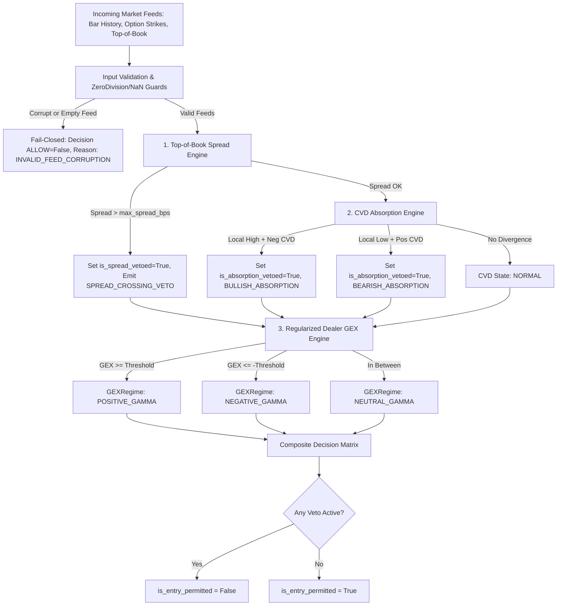

# Architecture Specification: FEAT-SENTINEL-MICROSTRUCTURE-SUITE-003

**Component**: `core/market_structure/sentinel_microstructure.py`  
**Test Suite**: `tests/unit/test_sentinel_microstructure.py`  
**Parent Epic**: `EPIC-SENTINEL-REGIME-SUPERVISORY`  
**Author**: Hermes Architect  
**Delivery Stage**: Stage 1 (Architecture, Contracts & Acceptance Gates)  
**Status**: APPROVED_FOR_GSD_EXECUTION  

---

## 1. Executive Summary & Architectural Scope

`FEAT-SENTINEL-MICROSTRUCTURE-SUITE-003` establishes a deterministic, scale-invariant, real-time microstructure supervisory engine within `core/market_structure/sentinel_microstructure.py`. It addresses critical execution vulnerabilities where TradeBot directional strategies enter breakout or continuation trades directly into institutional passive limit order absorption or hostile dealer gamma regimes, or execute across toxic/wide bid-ask spreads.

This module is **strictly read-only and supervisory**. It emits immutable gating decisions (`SentinelMicrostructureDecision`) containing fine-grained veto flags and regime telemetry. It executes zero broker calls, modifies zero orders, alters zero strategy thresholds, and contains zero live runtime wiring.

---

## 2. Adversarial Critique Integration (Grill Me Remediation)

To ensure high-integrity quantitative mechanics and avoid production pitfalls, the architecture incorporates rigorous solutions for all five adversarial review points raised by Grill Me:

| Grill Me Critique Point | Architectural Solution & Fail-Closed Guard |
|---|---|
| **1. Aggregated / Conflated Feed vs Tick Data** | `MarketBarSnapshot` supports both true tick-level aggressor volumes (`buy_volume`, `sell_volume`) and conflated/aggregated OHLCV bars via the standard **Lee-Ready Tick Rule / Quote Rule** proxy. If aggregated volume fails sign/conservation checks ($\|V_{buy} + V_{sell} - V_{total}\| > \epsilon$) or timestamps are out of order, the engine fails closed with `CVDState.UNKNOWN` and `is_absorption_vetoed = True`. |
| **2. Asymptotic Gamma Explosion as $T \to 0$** | Implements **Regularized Black-Scholes Gamma bounding**: $$\tau = \max(T, \tau_{min}) \quad \text{where } \tau_{min} = \frac{15 \text{ min}}{365 \times 24 \times 60} \approx 2.85 \times 10^{-5} \text{ years}$$ Additionally enforces a strict cap on normalized strike gamma $\Gamma_{reg} \le \Gamma_{max}$ to prevent infinite GEX spikes on expiry afternoons. |
| **3. Sign Convention & Dynamic Lot Sizing** | Net Dealer GEX explicitly models dealer inventory as the short counterparty to open interest: $$\text{GEX}_{strike} = \Gamma_{reg} \times S^2 \times (OI_{call} - OI_{put}) \times \text{lot\_size} \times \text{sign\_factor}$$ Supports dynamic `lot_size` per underlying (e.g. NIFTY=25/50, BANKNIFTY=15, single stocks) passed via contract metadata, eliminating hardcoded unit assumptions. |
| **4. Strict ZeroDivisionError & NaN Guards** | Every mathematical evaluation operates behind strict bounds checking: $S > 0$, $\sigma > \sigma_{floor} > 0$, $T > 0$, and checks `math.isnan()` / `math.isinf()`. Any anomalous value triggers an immediate fail-closed state (`StructuralSafetyViolation`). |
| **5. Bid-Ask Spread Crossing Filter** | Top-of-book spread is computed in basis points: $Spread_{bps} = \frac{P_{ask} - P_{bid}}{(P_{ask} + P_{bid}) / 2} \times 10,000$. If $Spread_{bps} > max\_spread\_bps$ or $P_{bid} \ge P_{ask}$ (crossed/locked book anomaly), triggers immediate `SPREAD_CROSSING_VETO` and vetoes entry. |

---

## 3. Data Contracts & Invariant Types

All contracts are immutable, frozen dataclasses residing in `core/market_structure/sentinel_microstructure.py`.

```python
from __future__ import annotations
import math
from dataclasses import dataclass, field
from enum import Enum
from typing import Sequence, Dict, Any, Optional

# Safety Invariant Declarations
SAFETY_DECLARATIONS = {
    "read_only": True,
    "is_order_action": False,
    "broker_api_called": False,
    "allowed_for_live_execution": False,
    "runtime_wiring_modified": False,
    "fail_closed_mode": True,
}

class CVDState(str, Enum):
    NORMAL = "NORMAL"
    BULLISH_ABSORPTION = "BULLISH_ABSORPTION"   # Price new high, CVD stagnant/negative -> Longs VETOED
    BEARISH_ABSORPTION = "BEARISH_ABSORPTION"   # Price new low, CVD stagnant/positive -> Shorts VETOED
    UNKNOWN = "UNKNOWN"

class GEXRegime(str, Enum):
    POSITIVE_GAMMA = "POSITIVE_GAMMA"   # High dealer long gamma, mean-reverting -> Breakouts VETOED
    NEGATIVE_GAMMA = "NEGATIVE_GAMMA"   # High dealer short gamma, volatility squeeze -> Breakouts ALLOWED
    NEUTRAL_GAMMA = "NEUTRAL_GAMMA"     # Unconstrained flow
    UNKNOWN = "UNKNOWN"

class MicrostructureVetoReason(str, Enum):
    NONE = "NONE"
    BULLISH_ABSORPTION_VETO = "BULLISH_ABSORPTION_VETO"
    BEARISH_ABSORPTION_VETO = "BEARISH_ABSORPTION_VETO"
    POSITIVE_GAMMA_FRICTION_VETO = "POSITIVE_GAMMA_FRICTION_VETO"
    SPREAD_CROSSING_VETO = "SPREAD_CROSSING_VETO"
    INVALID_FEED_CORRUPTION_VETO = "INVALID_FEED_CORRUPTION_VETO"

@dataclass(frozen=True)
class MarketBarSnapshot:
    timestamp: float
    open: float
    high: float
    low: float
    close: float
    volume: float
    buy_volume: Optional[float] = None
    sell_volume: Optional[float] = None

@dataclass(frozen=True)
class OptionStrikeSnapshot:
    strike_price: float
    call_oi: float
    put_oi: float
    implied_volatility: float
    dte_years: float                   # Time to expiry in annualized years

@dataclass(frozen=True)
class TopOfBookQuote:
    timestamp: float
    bid_price: float
    ask_price: float
    bid_size: float = 1.0
    ask_size: float = 1.0

@dataclass(frozen=True)
class MicrostructureParameters:
    cvd_lookback_bars: int = 14
    cvd_absorption_threshold_z: float = 1.2
    positive_gex_threshold: float = 1_000_000.0   # Scale-normalized gamma exposure boundary
    negative_gex_threshold: float = -1_000_000.0
    max_spread_bps: float = 6.0                  # Basis points threshold for crossing veto
    min_time_to_expiry_years: float = 15.0 / (365.0 * 24.0 * 60.0) # ~15 min regularizer
    min_implied_volatility: float = 0.05          # 5% IV floor
    max_gamma_cap: float = 100.0
    underlying_lot_size: int = 25

@dataclass(frozen=True)
class SentinelMicrostructureDecision:
    timestamp: float
    cvd_state: CVDState
    gex_regime: GEXRegime
    spread_bps: float
    is_absorption_vetoed: bool
    is_spread_vetoed: bool
    is_entry_permitted: bool
    veto_reasons: tuple[MicrostructureVetoReason, ...]
    cvd_divergence_metric: float
    net_dealer_gex: float
    audit_metadata: Dict[str, Any]
    safety_declarations: Dict[str, bool] = field(default_factory=lambda: dict(SAFETY_DECLARATIONS))
```

---

## 4. Mathematical Specifications & Microstructure Logic

### 4.1. Cumulative Volume Delta (CVD) & Passive Absorption Detection
1. **Delta Volume Calculation**:
   - If `buy_volume` and `sell_volume` are explicitly provided:
     $$\Delta V_t = V_{buy, t} - V_{sell, t}$$
   - If only total `volume` and OHLC are available (Aggregated Feed fallback):
     $$\Delta V_t = V_t \times \text{sign}(C_t - O_t) \quad \text{or Tick Rule proxy: } \Delta V_t = V_t \times \text{sign}(C_t - C_{t-1})$$
     With strict validation: $|V_{buy} + V_{sell} - V_t| \le 10^{-4}$ if split volumes exist.
   - Cumulative Volume Delta over lookback window $W$:
     $$CVD_t = \sum_{\tau=t-W+1}^t \Delta V_\tau, \quad \Delta CVD_W = CVD_t - CVD_{t-W+1}$$

2. **Divergence & Absorption Classification**:
   - **Bullish Absorption (Distribution into aggressive buying / Passive Ask Absorption)**:
     $$\text{Condition: } S_t \ge \max_{k \in [1, W]} High_{t-k} \quad \text{AND} \quad \Delta CVD_W \le 0$$
     Aggressive buyers are lifting the ask, but massive resting sell limit orders absorb flow without allowing upward price progression. High probability bull trap.
     $$\implies \text{Classify } \text{CVDState.BULLISH\_ABSORPTION}, \quad \text{emit } \text{BULLISH\_ABSORPTION\_VETO}$$
   - **Bearish Absorption (Accumulation into aggressive selling / Passive Bid Absorption)**:
     $$\text{Condition: } S_t \le \min_{k \in [1, W]} Low_{t-k} \quad \text{AND} \quad \Delta CVD_W \ge 0$$
     Aggressive sellers are hitting the bid, but massive resting buy limit orders absorb flow. High probability bear trap.
     $$\implies \text{Classify } \text{CVDState.BEARISH\_ABSORPTION}, \quad \text{emit } \text{BEARISH\_ABSORPTION\_VETO}$$
   - **Normal Flow**: Otherwise, `CVDState.NORMAL`.

### 4.2. Regularized Dealer Gamma Exposure (GEX) Engine
1. **Regularized Black-Scholes Gamma ($\Gamma_{reg}$)**:
   For each strike $K_i$, spot $S$, implied volatility $\sigma = \max(IV_i, \sigma_{floor})$, and time to expiry $\tau = \max(T_i, \tau_{min})$:
   $$d_1 = \frac{\ln(S / K_i) + \frac{1}{2} \sigma^2 \tau}{\sigma \sqrt{\tau}}$$
   $$\phi(d_1) = \frac{1}{\sqrt{2\pi}} e^{-\frac{1}{2} d_1^2}$$
   $$\Gamma_{raw} = \frac{\phi(d_1)}{S \sigma \sqrt{\tau}}$$
   $$\Gamma_{reg} = \min(\Gamma_{raw}, \Gamma_{max})$$

2. **Net Strike & Aggregate GEX**:
   Assuming market makers are net long calls when public is short, and short calls when public is long (standard dealer positioning assumption where public is net long OTM calls and puts):
   $$\text{Dealer GEX}_i = \Gamma_{reg, i} \times S^2 \times (OI_{call, i} - OI_{put, i}) \times \text{lot\_size}$$
   $$\text{Total GEX} = \sum_{i} \text{Dealer GEX}_i$$

3. **Regime Classification**:
   - `Total GEX >= positive_gex_threshold` $\implies$ `GEXRegime.POSITIVE_GAMMA`. Volatility dampening regime. Dynamic hedging forces dealers to buy dips and sell rips. Directional breakouts are faded.
   - `Total GEX <= negative_gex_threshold` $\implies$ `GEXRegime.NEGATIVE_GAMMA`. Volatility acceleration regime. Dynamic hedging forces dealers to sell dips and buy rips. High squeeze potential. Breakout continuation permitted.
   - Otherwise $\implies$ `GEXRegime.NEUTRAL_GAMMA`.

### 4.3. Top-of-Book Spread Threshold
1. Check for locked or crossed book: if $P_{ask} \le P_{bid}$, fail closed with `MicrostructureVetoReason.INVALID_FEED_CORRUPTION_VETO`.
2. Compute basis points spread:
   $$Spread_{bps} = \frac{P_{ask} - P_{bid}}{(P_{ask} + P_{bid}) / 2} \times 10,000$$
3. If $Spread_{bps} > max\_spread\_bps$, emit `SPREAD_CROSSING_VETO` and set `is_spread_vetoed = True`.

---

## 5. Decision Hierarchy & Composite Gating

The engine aggregates individual component evaluations through a deterministic fail-closed pipeline:



---

## 6. Implementation Architecture

### 6.1. File Layout
- **Module**: `core/market_structure/sentinel_microstructure.py`
  - Function: `evaluate_microstructure(bars: Sequence[MarketBarSnapshot], strikes: Sequence[OptionStrikeSnapshot], quote: TopOfBookQuote, spot_price: float, params: Optional[MicrostructureParameters] = None) -> SentinelMicrostructureDecision`
  - Helper functions:
    - `calculate_cvd_state(...) -> tuple[CVDState, float, bool]`
    - `calculate_dealer_gex(...) -> tuple[GEXRegime, float]`
    - `calculate_spread_bps(...) -> tuple[float, bool]`
    - `regularized_gamma(...) -> float`
- **Tests**: `tests/unit/test_sentinel_microstructure.py`
  - Exhaustive test cases covering all acceptance criteria, Grill Me scenarios, math boundaries, and edge cases.

---

## 7. Acceptance Proof Criteria & Test Gates

The GSD implementation phase must satisfy the following explicit test cases:

1. **`test_cvd_bullish_absorption_divergence_veto`**:
   - Spot price reaches new high across lookback window of 14 bars.
   - Traded volume delta is negative ($\Delta CVD \le 0$).
   - Asserts `cvd_state == CVDState.BULLISH_ABSORPTION`, `is_absorption_vetoed == True`, `is_entry_permitted == False`.
2. **`test_cvd_bearish_absorption_divergence_veto`**:
   - Spot price reaches new low across lookback window of 14 bars.
   - Traded volume delta is positive ($\Delta CVD \ge 0$).
   - Asserts `cvd_state == CVDState.BEARISH_ABSORPTION`, `is_absorption_vetoed == True`, `is_entry_permitted == False`.
3. **`test_cvd_aggregated_feed_tick_rule_fallback`**:
   - Only OHLCV provided without explicit buy/sell volume split.
   - Asserts fallback calculation properly reconstructs signed CVD and detects absorption.
4. **`test_regularized_dealer_gex_asymptotic_boundary_t_zero`**:
   - Option strike with $T = 0.0$ or $T = 10^{-7}$ years (expiry boundary).
   - Asserts no `ZeroDivisionError`, no `NaN`/`Inf`, and gamma is strictly bounded by `max_gamma_cap`.
5. **`test_dealer_gex_regime_classification_positive_and_negative`**:
   - Verifies transition between `POSITIVE_GAMMA`, `NEGATIVE_GAMMA`, and `NEUTRAL_GAMMA` using realistic option chain inputs and dynamic lot sizing (NIFTY lot=25).
6. **`test_top_of_book_spread_crossing_veto`**:
   - Tests quote with 7.5 bps spread against 6.0 bps limit.
   - Asserts `is_spread_vetoed == True`, `is_entry_permitted == False`, veto reason `SPREAD_CROSSING_VETO`.
7. **`test_locked_or_crossed_book_fails_closed`**:
   - Tests $P_{ask} \le P_{bid}$.
   - Asserts fail-closed handling with `INVALID_FEED_CORRUPTION_VETO`.
8. **`test_safety_invariants_preserved`**:
   - Verifies `read_only = True`, `broker_api_called = False`, `is_order_action = False`, `allowed_for_live_execution = False`.
   - Verifies frozen dataclass immutability.

---

## 8. Hermes Architectural Sign-Off

- **Stage**: Stage 1 Complete
- **Handoff Target**: GSD Execution Agent
- **Execution Mandate**: GSD must implement `core/market_structure/sentinel_microstructure.py` and `tests/unit/test_sentinel_microstructure.py` conforming strictly to the above contracts and acceptance gates, with no runtime wiring and no broker API calls.
